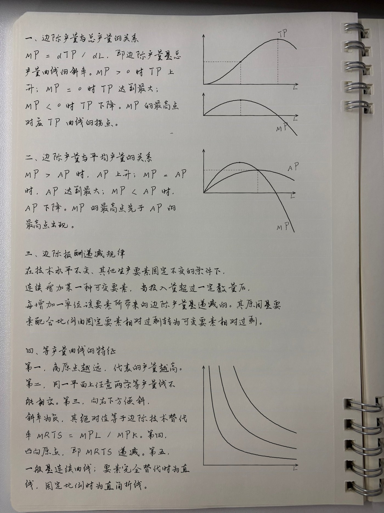
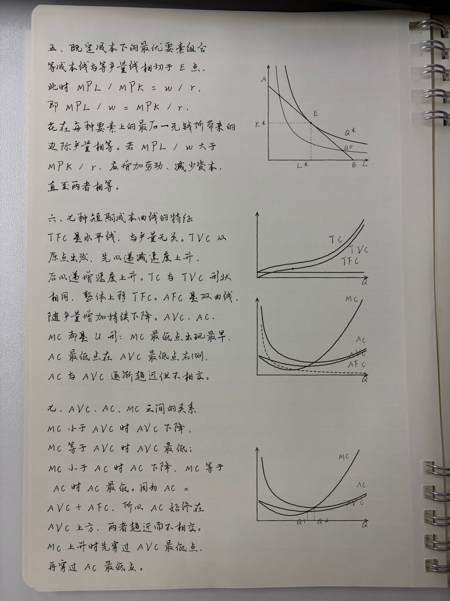

# 手写作业生成器 · handwriting-homework

**把一份答案文本 + 一张纸面照片，做成「像真人写在纸上」的作业。**

手写体文字、手绘风配图、自动分页排版，输出图片和 PDF。零第三方依赖，一条命令跑完。

> Turn an answer text into a homework that looks handwritten on real paper — auto pagination, text on the left / figure on the right, PNG + PDF output.





---

## 使用方法

**把这个链接交给会干活的 AI，剩下的事它来做。**

```
https://github.com/Ego00000000/handwriting-homework
```

这里说的「会干活」是指能执行命令、读写文件的那种 AI（Claude Code、Codex、Cursor、WorkBuddy 之类），不是只会聊天的对话框。

然后直接对它说：

> 装一下这个 skill，把我下面这段答案做成手写作业，用内置的纸面。
> （贴上答案文本）

后续想改什么也直接说，不用自己动代码：

- 「纸面换成横线本」「字体换二号」「这题配一张等产量线的图」
- 「一页放两题」「字大一点」「第 3 页重做一遍」
- 跑不通就把报错原样贴回去，让它自己看

安装、自检、排版、出图都由它完成。想自己动手或改代码，往下看[安装](#安装)和[快速开始](#快速开始)。

## 它做什么

| 输入 | 处理 | 输出 |
|---|---|---|
| 答案文本（`job.json` 或纯文本目录） | 提交手写服务渲染 → 拆成透明文字块 / 图形块 → 按纸面可写区自适应排版 | `第N页.png` + `手写稿.pdf` |
| 纸面照片（内置 12 张，或自己的） | 自动擦除横线、探测可写区、避开装订环 | 默认 纸面尺寸 ×1.6 |

**会做的**：换纸面、换字体（一号/二号两档）、有图题左文右图、无图题写满整行、一题一页或多题一页、按纸面比例自适应字号。

**不做的**：不生成题目内容（文本你给）；不做笔迹之外的照片编辑；图库里没有的图不会凭空画；**不做数学公式排版（见下节）**。

## 不适用于数学作业

本工具只做「一维字符排版」——每个字符按顺序横向排开，不理解公式的二维结构。所以：

- **上下标不会抬高或缩小**：写 `x^2` 会原样印出脱字符，`a₁` 的下标不会被压到基线以下
- **分式、根号覆盖线、积分上下限、矩阵、方程组、化学式**等二维排版一律不支持
- **部分 Unicode 数学符号缺字形会直接消失，且不报错**：实测 `₀¹`（下标数字）、`∂`（偏导符）渲染为空白，看着像漏字
- 能正常显示的只有基础单字符符号：`∫` `√` `≠` `≤` `∞` `∑` `→`

所以：**数学、物理、化学等以公式为主的作业不要用本项目。** 文字题里偶尔出现一个 `≤`、`∞` 没问题，成段的公式推导会明显露馅。

## 前置要求

- **Python ≥ 3.8**，零第三方依赖（只用标准库。装了 Pillow / numpy 会自动走加速轨，拆块快约 8 倍）
- **无头浏览器**：Edge 或 Chrome，脚本自动探测；找不到时用 `--edge` 或环境变量 `EDGE_PATH` 指定
- **网络**：渲染阶段需要访问手写服务（见下方「第三方服务」）

自检：

```bash
python scripts/hw.py doctor
```

输出 `结论: 可以开始生成` 就可以往下走了。

## 安装

当作 Agent Skill 用：

```bash
git clone https://github.com/Ego00000000/handwriting-homework.git

# WorkBuddy / CodeBuddy
mv handwriting-homework ~/.workbuddy/skills/

# 其他支持 Skill 的 agent：放进它的 skills 目录即可
```

当作命令行工具用：clone 下来直接 `python scripts/hw.py ...`，不需要装任何东西。

## 快速开始

```bash
# 1. 自检
python scripts/hw.py doctor

# 2. 用内置示例跑一遍
python scripts/hw.py build \
  --job templates/job.example.json \
  --out-dir "/abs/path/out"
```

产物在 `out/`：`第1页.png …` 和 `手写稿.pdf`。

写自己的作业，照 `templates/job.example.json` 的结构写一份 job：

```json
{
  "name": "我的作业",
  "paper": null,
  "font": "一号字体",
  "layout": { "mode": "multi", "figure_side": "right", "scale": 1.6, "wide_no_fig": true },
  "questions": [
    { "text": "第一题正文……", "figures": ["tp_mp"] },
    { "text": "第二题正文……" }
  ]
}
```

`figure` 留空就是纯文字题。可用的图名见 [`references/figures.md`](references/figures.md)（11 张经济学图形，含曲线、等产量线、成本族）。

## 命令

| 子命令 | 作用 |
|---|---|
| `doctor` | 自检：Python / 浏览器 / 接口 / 字体 / 依赖 |
| `fonts` | 列出手写服务上可用的字体 |
| `papers` | 列出内置纸面组及其使用顺序 |
| `paper` | 单张纸面：擦横线 + 探测可写区 |
| `build` | 一条命令跑完：渲染 → 拆块 → 排版 → 出图 + PDF |
| `render` / `extract` / `layout` | 分阶段单跑，调参时用 |
| `verify` | 校验尺寸、页数、是否残留整行黑线（加 `--deep` 逐页查） |

常用参数：`--paper` `--paper-dir` `--font` `--scale` `--one-per-page` `--no-wide` `--no-pdf` `--force` `--jobs N`。完整参数与阈值见 [`references/params.md`](references/params.md)。

## 内置 12 张纸面

`papers/` 里是 12 张已经去掉横线的白纸照片（1440×1920，同一本线圈本，右装订 6 张 / 左装订 6 张），**默认背景就是它**，按 `paper-01 → paper-12` 顺序一页一张，用完循环。

排版字号上限按 12 张可写区的**交集**算，落位时每页用**自己那张**的可写区——换页不会压到装订环，也不会溢出纸边。

想换一组纸：把图片丢进一个目录（命名 `xxx-01.png…`），加 `--paper-dir 该目录`。没写 `rects.json` 会走自动探测（纸面偏亮时探测可能不准，建议补一份）。

## 无图题写满整行

手写服务按「画布宽 ÷ 字号」决定一行放几个字：所有题共用一张画布时每行只能写 ~17 字，无图题的右边会空一大片。

这里的做法是**只给无图题换一张更宽的画布（3200 vs 2481），字号、行距、边距一个都不改**。纸上字大小由全篇统一的缩放系数决定，所以不会出现「同一页字不一样大」。关掉用 `--no-wide`。

## 目录结构

```
handwriting-homework/
├── SKILL.md                  Agent 的入口说明（触发条件、工作流、坑）
├── papers/                   12 张白纸 + rects.json（可写区）
├── scripts/
│   ├── hw.py                 CLI 主程序
│   ├── bench.py              拆块性能基线
│   └── lib/
│       ├── api.py            手写服务客户端
│       ├── edge.py           无头浏览器驱动
│       ├── paper.py          擦横线 + 可写区探测
│       ├── figures.py        11 张图的手绘风 SVG
│       ├── stage_*.py        渲染 / 拆块 / 排版三段
│       └── imgfast.py        纯标准库图像运算（无 Pillow 时的轨道）
├── references/               参数总表 / 图库 / 排错对照
├── templates/job.example.json
└── docs/                     README 用图
```

## 文档

- [`SKILL.md`](SKILL.md) —— 完整工作流与踩过的坑（横线残留、图形被裁、缓存指纹、队列退避）
- [`references/params.md`](references/params.md) —— 全部参数、阈值、默认值
- [`references/figures.md`](references/figures.md) —— 11 张图的名字、形态、适用题型
- [`references/troubleshooting.md`](references/troubleshooting.md) —— 报错对照表

## 第三方服务

文字渲染依赖 **`handwrite.sixiangjia.de`**——一个第三方手写服务，**非本项目所有，仓库内不含其服务端代码**。

- 每题 1 次接口调用（带图题再加 1 次标签调用），14 题约 25 次、耗时约 110 秒
- 队列满会返回 503 `queue_full` 或 429，脚本会按建议退避重试；连续失败就换个时间跑，别狂刷
- 该服务的可用性、配额、字体版权均不由本项目保证。若它变更或关闭，渲染环节会失效
- 字体只在服务端，本仓库不分发任何字体文件

如果要在自己的服务上跑，改 `scripts/lib/api.py` 里的 `BASE` 常量即可。

## 免责声明

本项目用于**排版、字体渲染与图像合成的技术演示**，以及个人笔记的整理打印。

请勿用于伪造他人笔迹、冒名提交作业或考试、伪造签名及其他可能造成误导或损害的用途。使用者对自己的输入内容和产出物负全部责任。

## License

[MIT](LICENSE) © 2026 Ego00000000
